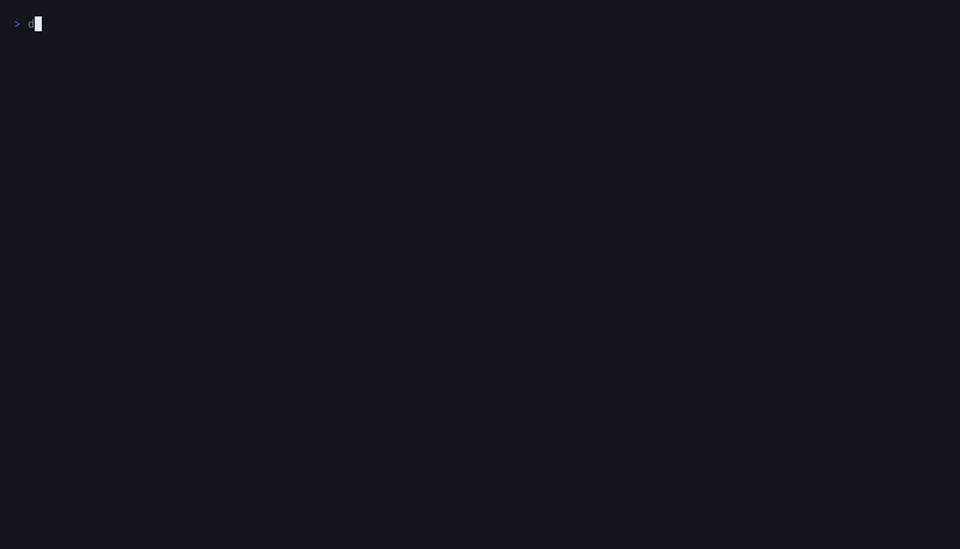
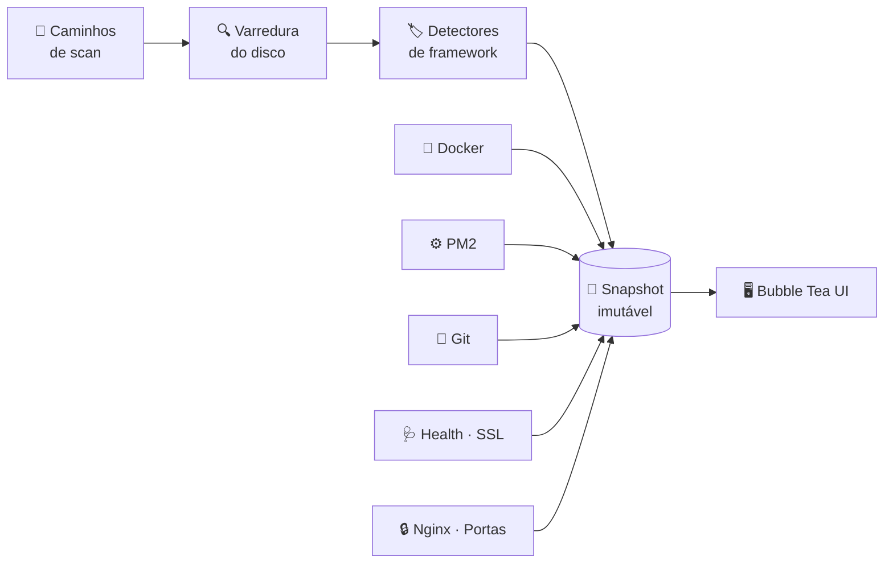

<div align="center">

# ◆ DevScope

### O `htop` dos seus projetos

Containers, Git, CI, túneis, banco e saúde de **todos** os seus projetos —
numa tela só, dentro do terminal.

<p>
  <a href="https://github.com/PirataZang/devscope/actions/workflows/ci.yml"></a>
  <a href="https://github.com/PirataZang/devscope/releases"></a>
  <a href="LICENSE"></a>
  
  
</p>

</div>

## 🚀 Instalação

Um comando, um binário. Sem Node, sem Python, sem daemon.

<table>
<tr>
<th width="50%">🐧 Linux &nbsp;·&nbsp; 🍎 macOS</th>
<th width="50%">🪟 Windows (PowerShell)</th>
</tr>
<tr>
<td valign="top">

```bash
curl -fsSL https://raw.githubusercontent.com/PirataZang/devscope/main/scripts/install.sh | bash
```

Detecta sistema e arquitetura (x64 / ARM64, Intel / Apple Silicon),
confere o checksum e instala em `/usr/local/bin` — ou em
`~/.local/bin`, já adicionado ao `PATH` do seu `.bashrc` / `.zshrc`.

</td>
<td valign="top">

```powershell
irm https://raw.githubusercontent.com/PirataZang/devscope/main/scripts/install.ps1 | iex
```

Instala em `%USERPROFILE%\.devscope\bin` e coloca a pasta no `PATH`
do usuário. Abra um terminal novo e pronto.

</td>
</tr>
</table>

Depois é só rodar:

```bash
devscope               # abre a TUI
devscope scan --json   # snapshot da máquina em JSON, para automação
devscope watch         # painel com auto-refresh, sem TUI interativa
devscope version       # versão, commit e data de build
```

<sub>Versão específica, outra pasta, download manual ou build from source? → [Instalação avançada](#-instalação-avançada)</sub>

---

<p align="center">
  
</p>

<div align="center">

**[Git](#-git-sem-sair-do-terminal)** ·
**[Docker](#-docker-por-projeto)** ·
**[Por que existe](#-por-que-existe)** ·
**[Módulos](#-15-módulos-um-contexto)** ·
**[Atalhos](#-atalhos-essenciais)** ·
**[Preferências](#-preferências)** ·
**[Arquitetura](#-como-funciona)**

<sub>Todas as gravações são do DevScope de verdade, rodando contra projetos de demonstração.</sub>

</div>

---

## ⚡ Em 30 segundos

<div align="center">
<table>
<tr>
<td width="25%" align="center">

### 📦
**Binário único**

Sem Node, sem Python,<br>sem daemon, sem browser

</td>
<td width="25%" align="center">

### 🔍
**Zero configuração**

Ele acha seus projetos<br>sozinho no disco

</td>
<td width="25%" align="center">

### ⚙️
**Opera, não só observa**

Commitar, subir, parar,<br>deploy, túnel, SQL

</td>
<td width="25%" align="center">

### 🧊
**Nunca trava**

Coleta concorrente,<br>UI sobre snapshot imutável

</td>
</tr>
</table>
</div>

**O que aparece no GIF acima:**

- 🌊 **Lista de projetos** — uma linha por projeto, com a **onda Braille** de estado (verde subindo é
  saudável, vermelho baixo é parado), stack detectada, branch e caminho. Embaixo, o resumo do projeto
  selecionado: stack, containers, portas, branch e último commit.
- 🔎 **Filtro ao vivo** (<kbd>/</kbd>) por nome, caminho, branch ou framework, e **busca fuzzy**
  (<kbd>Ctrl</kbd>+<kbd>P</kbd>) para pular direto para um projeto.
- 🧭 **Módulos do projeto** — <kbd>Tab</kbd> passa por Git, Worktrees, Tarefas, Containers, API e Database. Só
  aparecem os módulos que fazem sentido para aquele projeto.
- ❓ **Ajuda** (<kbd>?</kbd>) com todos os atalhos agrupados por cor, e **12 temas**
  (<kbd>Shift</kbd>+<kbd>T</kbd>) com preview na hora.

---

## 🌿 Git, sem sair do terminal

<p align="center">
  
</p>

<p align="center">
  <a href="docs/media/git.mp4"><b>▶ Assistir em vídeo (MP4, melhor qualidade)</b></a>
</p>

Abra um projeto com <kbd>Enter</kbd> (ou <kbd>g</kbd> direto da lista) e o Git do projeto está ali —
sem `cd`, sem decorar flag. O que o vídeo mostra, na ordem:

| | O que acontece | Tecla |
|---|---|---|
| 1 | **Cabeçalho** com branch atual, commits à frente do remoto (`↑2 p/ enviar`), modificados, novos e stashes | — |
| 2 | **Branches e commits lado a lado.** Mover o cursor numa branch mostra os commits dela *sem* fazer checkout (`(view)`) | <kbd>↑</kbd> <kbd>↓</kbd> |
| 3 | **Diff de um commit**, arquivo por arquivo, com numeração de linhas e busca no diff | <kbd>→</kbd> <kbd>Enter</kbd> |
| 4 | **Git Graph** — o DAG do repositório desenhado no terminal, com branches, tags, merges, stash e o detalhe do commit | <kbd>Ctrl</kbd>+<kbd>G</kbd> |
| 5 | **Diff do arquivo modificado** na árvore de alterações | <kbd>→</kbd> <kbd>Enter</kbd> |
| 6 | **Stage de tudo** — a árvore marca cada arquivo como `staged` | <kbd>Shift</kbd>+<kbd>A</kbd> |
| 7 | **Commit** num modal com contagem de staged/modified/untracked e preview da mensagem | <kbd>c</kbd> |
| 8 | **Log de comandos** abre sozinho: mostra o `git` exato que o DevScope rodou e a saída — nada acontece escondido | <kbd>Ctrl</kbd>+<kbd>L</kbd> |
| 9 | **Gaveta de stashes** | <kbd>s</kbd> |

<details>
<summary><b>⌨️ Todos os atalhos do Git</b></summary>

<br>

| Navegar | | Branches | | Alterações e commits | |
|---|---|---|---|---|---|
| <kbd>←</kbd> <kbd>→</kbd> | Branches / Commits / Arquivos | <kbd>Space</kbd> | checkout | <kbd>a</kbd> | stage / unstage do arquivo |
| <kbd>↑</kbd> <kbd>↓</kbd> | mover na coluna | <kbd>n</kbd> | criar branch | <kbd>Shift</kbd>+<kbd>A</kbd> | stage / unstage de todos |
| <kbd>Enter</kbd> | detalhe / diff | <kbd>d</kbd> | apagar (confirma) | <kbd>c</kbd> | novo commit |
| <kbd>b</kbd> | filtrar branches | <kbd>Shift</kbd>+<kbd>R</kbd> | renomear | <kbd>x</kbd> | marcar commit (cherry-pick) |
| <kbd>s</kbd> | gaveta de stashes | <kbd>Shift</kbd>+<kbd>M</kbd> | merge na atual | <kbd>Shift</kbd>+<kbd>C</kbd> | copiar marcados |
| <kbd>Ctrl</kbd>+<kbd>L</kbd> | log de comandos | <kbd>p</kbd> | pull | <kbd>Shift</kbd>+<kbd>V</kbd> | colar na branch atual |
| <kbd>Ctrl</kbd>+<kbd>G</kbd> | Git Graph | <kbd>Shift</kbd>+<kbd>P</kbd> | push | | |
| <kbd>r</kbd> | atualizar | <kbd>o</kbd> | abrir Pull Request no GitHub | | |

No **Git Graph**: <kbd>Tab</kbd> alterna commits / detalhe / arquivos, <kbd>Shift</kbd>+<kbd>B</kbd>
filtra por branch e <kbd>←</kbd> <kbd>→</kbd> rolam na horizontal.

</details>

---

## 🐳 Docker, por projeto

<p align="center">
  
</p>

<p align="center">
  <a href="docs/media/docker.mp4"><b>▶ Assistir em vídeo (MP4, melhor qualidade)</b></a>
</p>

<kbd>c</kbd> na lista abre os containers **só daquele projeto** — a correlação é feita pelo diretório
do `docker compose` e pelos mounts, então o `postgres` do projeto A não se mistura com o do projeto B.

| | O que acontece | Tecla |
|---|---|---|
| 1 | **Lista com estado, imagem, portas, CPU e memória**, e embaixo o detalhe e os **logs ao vivo** do container selecionado | <kbd>↑</kbd> <kbd>↓</kbd> |
| 2 | **Portas publicadas** e **preview HTTP**: o DevScope faz o `GET` e mostra status, headers e corpo ali mesmo | <kbd>Enter</kbd> <kbd>Enter</kbd> |
| 3 | **Detalhe em 7 abas** — logs · métricas · env · config · processos · compose · arquivos | <kbd>m</kbd> · <kbd>1</kbd>…<kbd>7</kbd> |
| 4 | **Métricas** de CPU, memória, rede, I/O de bloco e PIDs | <kbd>2</kbd> |
| 5 | **Variáveis de ambiente com segredos mascarados** — `POSTGRES_PASSWORD` vira `s3••••••••`. Pode abrir em call e tirar print | <kbd>3</kbd> |
| 6 | **Parar e iniciar** o container; a onda de estado e o status acompanham em tempo real | <kbd>s</kbd> · <kbd>r</kbd> |

<details>
<summary><b>⌨️ Todos os atalhos de Containers</b></summary>

<br>

| Containers | | Compose e imagens | | Detalhe do container | |
|---|---|---|---|---|---|
| <kbd>Enter</kbd> | portas + preview HTTP | <kbd>Shift</kbd>+<kbd>U</kbd> | `compose up` | <kbd>1</kbd>…<kbd>7</kbd> | trocar de aba |
| <kbd>m</kbd> | detalhe (7 abas) | <kbd>Shift</kbd>+<kbd>D</kbd> | `compose down` | <kbd>/</kbd> <kbd>n</kbd> <kbd>N</kbd> | buscar nos logs |
| <kbd>s</kbd> · <kbd>r</kbd> | parar / iniciar e reiniciar | <kbd>Shift</kbd>+<kbd>B</kbd> | `compose up --build` | <kbd>f</kbd> · <kbd>p</kbd> | acompanhar / pausar logs |
| <kbd>p</kbd> · <kbd>d</kbd> | pausar / remover (confirma) | <kbd>n</kbd> | novo serviço (Docker Hub ou YAML) | <kbd>←</kbd> <kbd>→</kbd> | rolar na horizontal |
| <kbd>Shift</kbd>+<kbd>E</kbd> | shell dentro do container | <kbd>i</kbd> | imagens do container | <kbd>r</kbd> | recarregar |
| <kbd>Shift</kbd>+<kbd>R</kbd> | alternar `restart=always` | <kbd>Shift</kbd>+<kbd>A</kbd> | (em imagens) escopo: container → projeto → todas | | |
| <kbd>Shift</kbd>+<kbd>A</kbd> | incluir containers de outros projetos | <kbd>Shift</kbd>+<kbd>D</kbd> | (em imagens) remover imagem | | |

Nas **portas**: <kbd>Enter</kbd> faz o preview HTTP, <kbd>o</kbd> abre no navegador e <kbd>x</kbd>
fecha a porta no Docker. Também há módulos de **Swarm** (services, nodes, stacks, deploy, rollback) e
**Kubernetes** (workloads, logs, yaml, escalar) para quando o projeto pede.

</details>

---

## 🔥 Por que existe

Você trabalha em **projetos**. Suas ferramentas trabalham em outra unidade — processo,
container, serviço, repositório. Saber como está tudo, numa manhã de segunda, custa isso:

<table>
<tr>
<th width="50%">😩 Antes</th>
<th width="50%">😌 Depois</th>
</tr>
<tr>
<td valign="top">

```bash
docker ps -a                   # o que está de pé
docker stats --no-stream       # consumindo o quê
pm2 list                       # e os workers Node
git -C /var/www/api status     # o que ficou solto
gh run list                    # a pipeline passou
ss -ltn | grep LISTEN          # quem pegou a 8080
nginx -T | grep server_name    # que domínio é esse
certbot certificates           # e o SSL, vence quando
```

Oito comandos, oito formatos de saída — e **nenhum deles sabe**
que tudo aquilo é o mesmo projeto.

</td>
<td valign="top">

```bash
devscope
```

<br>

Um binário. Ele varre o disco, detecta a stack, correlaciona
containers, workers, portas, domínios e certificados **ao
projeto certo** — e deixa você operar tudo dali, sem sair
do terminal.

</td>
</tr>
</table>

---

## 🧩 16 módulos, um contexto

Cada módulo aparece **só quando faz sentido** para o projeto aberto — um projeto Go sem Docker
não mostra a aba de containers (<kbd>t</kbd> mostra todos). A cor é a cor da categoria, no app inteiro.

<table>
<tr>
<td width="33%" valign="top">

#### 🏠 PROJETO
`Visão Geral`
> stack, saúde, containers,
> git e atividade num painel

#### 🟡 CÓDIGO
`Git` · `Worktrees` · `Releases`
`GH Actions` · `Jenkins`
> branches, commits, PR, graph,
> worktrees, releases, runs, trigger

</td>
<td width="33%" valign="top">

#### 🐳 EXECUÇÃO
`Tarefas` · `Containers` · `Swarm` · `Kubernetes`
> make/npm/just, start/stop, shell,
> logs, stats, services, pods

#### 🟢 REDE
`Nginx` · `Cloudflare` · `Ngrok` · `CF Tunnel`
> vhosts, acessos do domínio,
> expor o local, URL

</td>
<td width="33%" valign="top">

#### 🩷 DADOS
`API` · `Database`
> cliente HTTP e SQL,
> sem sair da tela

#### 🛠️ MESA
`JSON` · `JWT`
> formatar/consultar JSON e
> inspecionar/validar tokens

</td>
</tr>
</table>

<div align="center">
<sub>

**Também no pacote:** health checks HTTP/TCP · validade de SSL (Let's Encrypt) · portas abertas ·
workers PM2 · `docker compose up/down/restart` · deploy com confirmação · 12 temas · Git Graph

</sub>
</div>

---

## 🏷️ Releases: lançar uma versão sem esquecer passo

O módulo **Releases** (grupo CÓDIGO) aparece em **qualquer repositório git**. Ele mostra a última
versão, quantos commits entram, sugere a próxima (patch · minor · major com <kbd>←</kbd><kbd>→</kbd>)
e confere o que bloqueia antes de deixar lançar. <kbd>Enter</kbd> cria a tag anotada e envia; se
houver workflow de release, a tela acompanha até publicar.

O que ele usa — só o remoto é obrigatório:

| peça | para que serve | sem ela |
|---|---|---|
| **remoto `origin`** | é para onde a tag vai | não há release (`git remote add origin <url>`) |
| **tags `vX.Y.Z`** | a próxima versão sai da última tag semver; `nightly`, `deploy-prod` etc. são ignoradas | a primeira release começa a numeração (`v0.0.1`, `v0.1.0` ou `v1.0.0`) |
| **`CHANGELOG.md`** | a seção `## [1.7.0] - 2026-10-18` ([Keep a Changelog](https://keepachangelog.com/)) vira a mensagem da tag e define a versão sugerida | a tag leva a lista de commits — o DevScope oferece criar (veja abaixo) |
| **workflow de tag** (`.github/workflows/release.yml` com `on: push: tags: ["v*"]`) | publica a release quando a tag chega ao GitHub — binários, página, notas | a tag só marca o commit — o DevScope oferece criar (veja abaixo) |
| **`gh`** (GitHub CLI, com `gh auth login`) | acompanha o workflow ao vivo e mostra o resultado das releases anteriores | a release sai igual, só não dá para acompanhar daqui |

**Sem workflow ou sem CHANGELOG?** Ao pedir o release (<kbd>Enter</kbd>), ou a qualquer hora com
<kbd>w</kbd>, o DevScope cria o que faltar, commita **só esses arquivos** e envia a branch — o
workflow precisa estar no commit da tag para o GitHub rodá-lo.

- **`.github/workflows/release.yml`** — o modelo segue o projeto: com `.goreleaser.yaml`,
  **goreleaser** (binários por sistema); sem, **GitHub Release** com a mensagem da tag como notas.
- **`CHANGELOG.md`** — no formato Keep a Changelog, com um `## [Unreleased]` pronto e um bloco de
  **instruções para IA** num comentário (invisível no GitHub). Peça a qualquer agente — Claude,
  Copilot, Cursor — para "atualizar o CHANGELOG": ele lê as regras antes e escreve no formato que o
  Releases lê (levantar as mudanças com `git log` desde a última tag, um item por mudança que o
  usuário percebe, escolher patch/minor/major pelo maior impacto, renomear `[Unreleased]` para
  `[X.Y.Z] - data` na hora de lançar).

Recusou? O próximo <kbd>Enter</kbd> lança sem eles.

**Bloqueiam o lançamento:** alteração sem commit, commit não enviado, branch sem upstream e nada
novo desde a última tag. **Só avisam:** estar fora da branch padrão, o remoto ter commits que você
não tem e o CHANGELOG não ter a seção da versão. A mesma explicação aparece na própria tela, na
seção **COMO FUNCIONA**, com o estado do repositório aberto.

---

## 🌐 Publicar um projeto no nginx em um passo

Para quem hospeda vários projetos atrás de um **nginx-main** (container nginx com `conf.d/main.conf`
incluindo `sites/*.inc`): abra o projeto, aba **Nginx**, <kbd>p</kbd> e <kbd>Enter</kbd>. Nenhum
caminho nem porta digitados.

O DevScope detecta tudo e mostra a `.inc` pronta antes de publicar:

| o quê | de onde |
|---|---|
| **slug** (`/<projeto>/`) | o nome da pasta |
| **porta do back-end** | `BACKEND_PORT` no `.env` → `ports` do serviço `backend` no compose (com `${VAR:-padrão}` resolvido) → container `<projeto>_backend` no ar |
| **build do front** | o primeiro de `frontend/dist`, `dist`, `web/dist`, `client/dist`, `frontend/build`, `build` com `index.html`; sem build e com Vite no `package.json`, "build pendente" |
| **perfil** | back-end + build → `saas` · só build → `front` · só back-end → `api` |

Duas portas ou dois builds candidatos? Ele não chuta: <kbd>e</kbd> cai no campo e <kbd>↑</kbd><kbd>↓</kbd>
percorre as opções. **Bloqueiam:** outra `.inc` do hub já usando `/<projeto>` (<kbd>o</kbd> abre
ela), porta ou build não encontrados, pasta fora de `~/projetos`. **Só avisam:** `base` do
`vite.config` diferente de `/<projeto>/`, `VITE_API_URL` que não termina em `/<projeto>/api`, build
com assets em `/assets/`, `APP_URL` do Laravel sem o prefixo e `TrustProxies` que não confia no
gateway.

<kbd>Enter</kbd> executa, mostrando cada passo ao vivo:

1. escreve `sites/<projeto>.inc` (temporário + rename; a anterior vira `.inc.bak`);
2. `docker exec nginx-main nginx -t` — **recusou, desfaz a escrita e não recarrega** (a linha apontada
   fica destacada na prévia);
3. `nginx -s reload`;
4. smoke test: `GET /<projeto>` → 301, `GET /<projeto>/` → 200 html, `GET /<projeto>/api/` → qualquer
   coisa menos 502/504.

Republicar mostra o diff com a que está no ar e pede confirmação; rotas extras (<kbd>+</kbd>, ex.:
`/portal/` → `/<projeto>$request_uri`) e limites ajustados à mão na `.inc` publicada são mantidos.
O DevScope nunca toca em `conf.d/`, `nginx.conf` nem na `.inc` de outro projeto.

Sem a TUI, o mesmo código:

```bash
devscope nginx publish financial-bot --dry-run    # .inc + checagens, sem tocar em nada
devscope nginx publish financial-bot --port 8001  # --dist, --profile, --slug, --extra /portal/
devscope nginx unpublish financial-bot            # remove, testa e recarrega
```

Sai com código ≠ 0 se uma checagem bloquear, o `nginx -t` recusar ou o smoke test falhar. O
ambiente — pasta do nginx-main, container, IP público, gateway `172.17.0.1`, `~/projetos` →
`/var/www/html` — é lido do `docker-compose.yml` e do `conf.d/` do nginx-main; o que precisar
fixar vai na seção `Nginx:` do `user_config.txt`.

---

## ☁️ Cloudflare: quem acessa o domínio do projeto

O módulo **Cloudflare** (grupo REDE) abre na lista de **domínios** da conta, como no painel da
Cloudflare: estado, plano e a semana de visitantes de cada um, com os deste projeto no topo.
<kbd>enter</kbd> abre o domínio em três abas, e <kbd>esc</kbd> volta para a lista:

| aba | mostra |
|---|---|
| <kbd>1</kbd> tráfego | visitantes e páginas comparados com o período anterior (7 ou 30 dias, <kbd>←</kbd><kbd>→</kbd>), cache, respostas 2xx–5xx numa barra, ameaças, países, as últimas 24 horas hora a hora, uma barra por dia, as páginas mais acessadas e os caminhos com erro |
| <kbd>2</kbd> DNS | os registros, para onde apontam e quais passam pelo proxy |
| <kbd>3</kbd> segurança | modo SSL explicado em palavras, HTTPS forçado, TLS mínimo, validade do certificado, os avisos do Security Center e quando o registro do domínio vence (RDAP, inclusive registro.br) |

<kbd>w</kbd> abre o site e <kbd>o</kbd> abre a mesma tela no painel da Cloudflare.

**Conectar uma vez, só leitura:**

```bash
devscope cloudflare login     # cola um API Token (modelo "Read all resources")
devscope cloudflare status    # os domínios que o token enxerga
```

Ou exporte `CLOUDFLARE_API_TOKEN`. O token fica em `~/.config/devscope/cloudflare.token`, só para o
seu usuário, e o DevScope nunca muda nada na conta.

**O módulo só aparece no projeto que tem um domínio da conta:**

- o site do **Cloudflare Pages** está ligado ao mesmo repositório do GitHub; ou
- um endereço do domínio aparece em `.env`, `CNAME`, `package.json`, `astro.config`, `nginx.conf`
  ou `wrangler.toml`; ou
- você vinculou à mão: <kbd>t</kbd> mostra todos os módulos, na aba Cloudflare escolha o domínio
  e <kbd>v</kbd> grava `.devscope/cloudflare.txt` no projeto.

---

## ⌨️ Atalhos essenciais

O DevScope tem três camadas de atalho: **global** (vale em qualquer tela), **contextual** (vale na
tela atual) e **local** (vale no módulo aberto). A local vence. <kbd>?</kbd> mostra tudo, em qualquer tela.

| Tecla | Na tela inicial | Tecla | Em qualquer lugar |
|---|---|---|---|
| <kbd>↑</kbd> <kbd>↓</kbd> | navegar nos projetos | <kbd>Tab</kbd> · <kbd>Shift</kbd>+<kbd>Tab</kbd> | próximo / anterior módulo |
| <kbd>Enter</kbd> · <kbd>g</kbd> | abrir no Git | <kbd>Esc</kbd> | voltar um nível |
| <kbd>c</kbd> | abrir nos Containers | <kbd>t</kbd> | mostrar todos os módulos |
| <kbd>/</kbd> | filtrar ao vivo | <kbd>?</kbd> | ajuda |
| <kbd>Ctrl</kbd>+<kbd>P</kbd> | busca fuzzy | <kbd>Ctrl</kbd>+<kbd>O</kbd> | agente de IA na pasta do projeto |
| <kbd>Shift</kbd>+<kbd>E</kbd> | terminal no diretório do projeto | <kbd>q</kbd> | sair |
| <kbd>Shift</kbd>+<kbd>T</kbd> | escolher tema | | |
| <kbd>Shift</kbd>+<kbd>C</kbd> | preferências | | |
| <kbd>1</kbd>…<kbd>9</kbd> <kbd>0</kbd> | seus comandos cadastrados | | |

---

## 🎛️ Preferências

<kbd>Shift</kbd>+<kbd>C</kbd> abre o painel de preferências **dentro** do DevScope — tema,
atalhos e agente de IA, aplicados na hora, sem reiniciar.

```yaml
# ~/.config/devscope/user_config.txt  (texto comentado, editável à mão)
Theme: dracula-vivid

Commands: {
  "1": {"name": "Abrir a pasta", "command": "xdg-open . &"},
  "2": {"name": "Obsidian",      "command": "obsidian &"},
  "3": {"name": "Lazygit",       "command": "lazygit"}
}

AI: claude

Nginx: {
  "dir": "~/projetos/nginx-main",
  "public_host": "178.104.78.64"
}
```

<kbd>1</kbd>…<kbd>9</kbd> <kbd>0</kbd> disparam seus comandos (`&` no fim abre solto) ·
<kbd>Ctrl</kbd>+<kbd>O</kbd> chama o agente de IA · <kbd>Ctrl</kbd>+<kbd>R</kbd> volta tudo ao
padrão (com backup em `user_config.bak.txt`).

<details>
<summary><b>⚙️ Configuração do scanner (onde procurar, de quanto em quanto tempo)</b></summary>

<br>

```bash
mkdir -p ~/.config/devscope
cp configs/devscope.example.yaml ~/.config/devscope/config.yaml
```

```yaml
scan:
  paths: [/var/www, /home, /opt]
  max_depth: 5
  ignore: [node_modules, vendor, .git]

refresh:
  scan_interval: 10s
  metrics_interval: 2s
  health_interval: 10s
  git_interval: 30s

health:
  timeout: 5s
  concurrent: 10

pinned:
  - /var/www/projeto
```

Qualquer chave aceita variável de ambiente com o prefixo `DEVSCOPE_`:

```bash
DEVSCOPE_SCAN_PATHS=/var/www,/home/usuario/projetos devscope
```

</details>

---

## 📥 Instalação avançada

**Versão específica**

```bash
DEVSCOPE_VERSION=0.1.0 curl -fsSL https://raw.githubusercontent.com/PirataZang/devscope/main/scripts/install.sh | bash
```

```powershell
$env:DEVSCOPE_VERSION="0.1.0"; irm https://raw.githubusercontent.com/PirataZang/devscope/main/scripts/install.ps1 | iex
```

**Outra pasta de instalação**

```bash
DEVSCOPE_INSTALL_DIR=/usr/local/bin curl -fsSL https://raw.githubusercontent.com/PirataZang/devscope/main/scripts/install.sh | bash
```

```powershell
$env:DEVSCOPE_INSTALL_DIR="C:\Tools\devscope"; irm https://raw.githubusercontent.com/PirataZang/devscope/main/scripts/install.ps1 | iex
```

**Git Bash / MSYS2 no Windows** — o `install.sh` também funciona lá e instala em `~/.local/bin`.

**Download direto** — binários em [Releases](https://github.com/PirataZang/devscope/releases),
cada um com `checksums.txt`:

| Plataforma | Arquivo |
|---|---|
| Linux x64 / ARM64 | `devscope_*_linux_amd64.tar.gz` · `devscope_*_linux_arm64.tar.gz` |
| macOS Intel / Apple Silicon | `devscope_*_darwin_amd64.tar.gz` · `devscope_*_darwin_arm64.tar.gz` |
| Windows x64 / ARM64 | `devscope_*_windows_amd64.zip` · `devscope_*_windows_arm64.zip` |

**Build from source** (Go 1.24+)

```bash
git clone https://github.com/PirataZang/devscope.git && cd devscope
make build        # binário em ./bin/devscope
make run          # compila e executa
make install-dev  # substitui o devscope que está no seu PATH
```

**Desinstalar** — é um binário só: apague o `devscope` de onde ele foi instalado (`command -v devscope`
mostra onde) e, se quiser, a pasta `~/.config/devscope`.

---

## 🏗️ Como funciona



Os coletores rodam concorrentes e publicam snapshots **imutáveis** num `StateStore`. A UI nunca
lê dado mutável: ela desenha o último snapshot e segue — é isso que faz a tela não congelar
esperando um `docker inspect` lento.

| Documento | O que você encontra lá |
|---|---|
| 📐&nbsp;**[ARCHITECTURE.md](docs/ARCHITECTURE.md)** | Por que Go + Bubble Tea, o modelo de snapshot imutável, como cada coletor funciona e como escrever um novo detector de framework. |
| 🎨&nbsp;**[DESIGN.md](docs/DESIGN.md)** | O padrão de **todas** as telas: anatomia, teclado, vocabulário Braille, cores, larguras, anti-padrões e o checklist antes de entregar uma tela. |
| 🗺️&nbsp;**[ROADMAP.md](docs/ROADMAP.md)** | O que já foi entregue por versão e o que vem — do MVP ao multi-host. |

<div align="center">
<sub>

Go 1.24+ · [Bubble Tea](https://github.com/charmbracelet/bubbletea) (modelo Elm) ·
[Lip Gloss](https://github.com/charmbracelet/lipgloss) · Cobra + Viper

</sub>
</div>

---

## 🤝 Contribuindo

<div align="center">

[](https://github.com/PirataZang/devscope/issues/new?template=bug_report.md)
[](https://github.com/PirataZang/devscope/issues/new?template=feature_request.md)

</div>

Antes de mexer na UI, leia o **[DESIGN.md](docs/DESIGN.md)** — ele define o padrão de todas as
telas e é o que evita cada módulo virar uma ilha.

Mudou uma tela que aparece nos GIFs? Regrave com `docs/media/tapes/record.sh` (precisa só de Docker,
ffmpeg e Python com Pillow). Ele cria projetos de demonstração, grava com o
[VHS](https://github.com/charmbracelet/vhs) e aplica o zoom — nada da sua máquina aparece no vídeo.

---

<div align="center">
<sub>

Feito para quem vive entre vários projetos ao mesmo tempo · [MIT](LICENSE)

</sub>
</div>
