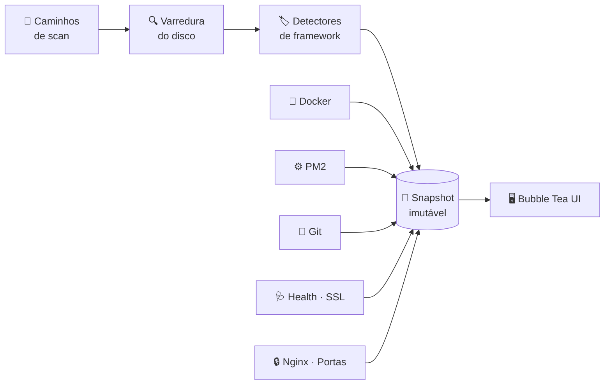

<div align="center">

# ◆ DevScope

### O `htop` dos seus projetos

Containers, Git, CI, túneis, banco e saúde de **todos** os seus projetos —
numa tela só, dentro do terminal.

<p>
  <a href="https://github.com/PirataZang/devscope/actions/workflows/ci.yml"></a>
  <a href="https://github.com/PirataZang/devscope/releases"></a>
  <a href="LICENSE"></a>
  
  
</p>

**[Instalar](#-instalação)** ·
**[Por que existe](#-por-que-existe)** ·
**[Tour](#-tour)** ·
**[Módulos](#-15-módulos-um-contexto)** ·
**[Preferências](#-preferências)** ·
**[Arquitetura](#-como-funciona)**

</div>

```
  ╭ DevScope v0.1.0  Developer Command Center                     CPU 4%  RAM 22%  DISK 40%   09:34:23
  │ Linux arm64 · up 149d 12h · load 0.03 · docker 8 · 1.6/7.3 GB                        varrido agora
  ├ PROJETOS 5   ⣷ 4 rodando  ⣄ 1 parado                   / filtrar · nome, path, branch ou framework
  │        NOME                    STACK     BRANCH             CTR COMMIT CAMINHO
  │ ──────────────────────────────────────────────────────────────────────────────────────────────────
  │ ▌ ⣷⣄⣀⡀ botrpg                  Node.js   main                 2      — ~/bots/botrpg
  │   ⣷⣄⣀⡀ laravel-sync            Laravel   main                 7      — ~/projetos/laravel-sync
  │   ⣷⣄⣀⡀ nginx-main              Docker    —                    1      — ~/projetos/nginx-main
  │   ⣷⣄⣀⡀ portfolio               Node.js   main                 1      — ~/projetos/portfolio
  │   ⣀⣀⣀⡀ peppercore-site         Vue       main                 1      — …projetos/peppercore-site
  │ ──────────────────────────────────────────────────────────────────────────────────────────────────
  │ ⣷⣄⣀⡀ botrpg   ~/bots/botrpg
  │ Node.js · main · 2 containers
  ╰  ↑↓ navegar · ENTER git · c containers · / filtrar · ^p fuzzy · S-E terminal     ? ajuda · q sair
```

<div align="center">
<sub><b>Uma linha por projeto:</b> estado animado · stack detectada · branch · containers · portas · caminho</sub>
</div>

---

## ⚡ Em 30 segundos

<div align="center">
<table>
<tr>
<td width="25%" align="center">

### 📦
**Binário único**

Sem Node, sem Python,<br>sem daemon, sem browser

</td>
<td width="25%" align="center">

### 🔍
**Zero configuração**

Ele acha seus projetos<br>sozinho no disco

</td>
<td width="25%" align="center">

### ⚙️
**Opera, não só observa**

Subir, parar, commitar,<br>deploy, túnel, SQL

</td>
<td width="25%" align="center">

### 🧊
**Nunca trava**

Coleta concorrente,<br>UI sobre snapshot imutável

</td>
</tr>
</table>
</div>

---

## 🔥 Por que existe

Você trabalha em **projetos**. Suas ferramentas trabalham em outra unidade — processo,
container, serviço, repositório. Saber como está tudo, numa manhã de segunda, custa isso:

<table>
<tr>
<th width="50%">😩 Antes</th>
<th width="50%">😌 Depois</th>
</tr>
<tr>
<td valign="top">

```bash
docker ps -a                   # o que está de pé
docker stats --no-stream       # consumindo o quê
pm2 list                       # e os workers Node
git -C /var/www/api status     # o que ficou solto
gh run list                    # a pipeline passou
ss -ltn | grep LISTEN          # quem pegou a 8080
nginx -T | grep server_name    # que domínio é esse
certbot certificates           # e o SSL, vence quando
```

Oito comandos, oito formatos de saída — e **nenhum deles sabe**
que tudo aquilo é o mesmo projeto.

</td>
<td valign="top">

```bash
devscope
```

<br>

Um binário. Ele varre o disco, detecta a stack, correlaciona
containers, workers, portas, domínios e certificados **ao
projeto certo** — e deixa você operar tudo dali, sem sair
do terminal.

</td>
</tr>
</table>

---

## 🚀 Instalação

**🐧 Linux · 🍎 macOS**

```bash
curl -fsSL https://raw.githubusercontent.com/PirataZang/devscope/main/scripts/install.sh | bash
```

**🪟 Windows (PowerShell)**

```powershell
irm https://raw.githubusercontent.com/PirataZang/devscope/main/scripts/install.ps1 | iex
```

Pronto — quatro comandos, um binário:

```bash
devscope               # abre a TUI
devscope scan --json   # snapshot da máquina em JSON, para automação
devscope watch         # painel com auto-refresh, sem TUI interativa
devscope version       # versão, commit e data de build
```

<details>
<summary><b>📥 Versão específica, diretório customizado, download manual e build from source</b></summary>

<br>

**Versão específica**

```bash
DEVSCOPE_VERSION=0.1.0 curl -fsSL https://raw.githubusercontent.com/PirataZang/devscope/main/scripts/install.sh | bash
```

```powershell
$env:DEVSCOPE_VERSION="0.1.0"; irm https://raw.githubusercontent.com/PirataZang/devscope/main/scripts/install.ps1 | iex
```

**Diretório de instalação**

```bash
DEVSCOPE_INSTALL_DIR=/usr/local/bin curl -fsSL https://raw.githubusercontent.com/PirataZang/devscope/main/scripts/install.sh | bash
```

```powershell
$env:DEVSCOPE_INSTALL_DIR="C:\Tools\devscope"; irm https://raw.githubusercontent.com/PirataZang/devscope/main/scripts/install.ps1 | iex
```

**Download direto** — binários em [Releases](https://github.com/PirataZang/devscope/releases),
cada um com `checksums.txt`:

| Plataforma | Arquivo |
|---|---|
| Linux x64 / ARM64 | `devscope_*_linux_amd64.tar.gz` · `devscope_*_linux_arm64.tar.gz` |
| macOS Intel / Apple Silicon | `devscope_*_darwin_amd64.tar.gz` · `devscope_*_darwin_arm64.tar.gz` |
| Windows x64 / ARM64 | `devscope_*_windows_amd64.zip` · `devscope_*_windows_arm64.zip` |

**Build from source** (Go 1.24+)

```bash
git clone https://github.com/PirataZang/devscope.git && cd devscope
make build        # binário em ./bin/devscope
make run          # compila e executa
make install-dev  # instala no PATH de desenvolvimento
```

Ou `go install github.com/devscope/devscope/cmd/devscope@latest` — com `$GOPATH/bin` no `PATH`.

</details>

---

## 🎬 Tour

Três telas, o mesmo padrão. Tudo abaixo é o DevScope de verdade — desenhado com
caractere de terminal, não com imagem.

### 1 · A lista de projetos

```
 ⌂ INÍCIO   5 projetos                              CPU 4% ⣤⣦ · RAM 22% ⣀⣄ · DISK 40%   09:34:23
 ─────────────────────────────────────────────────────────────────────────────────────────────
        NOME               STACK      BRANCH        CTR   CAMINHO
 ▌ ⣷⣄⣀⡀ botrpg             Node.js    main            2   ~/bots/botrpg
   ⣷⣄⣀⡀ laravel-sync       Laravel    main            7   ~/projetos/laravel-sync
   ⣷⣄⣀⡀ portfolio          Node.js    main            1   ~/projetos/portfolio
   ⣀⣀⣀⡀ peppercore-site    Vue        main            1   …/projetos/peppercore-site
 ─────────────────────────────────────────────────────────────────────────────────────────────
 ⣷⣄⣀⡀ botrpg   ~/bots/botrpg
   stack     Node.js · pnpm          git       main · limpo
   runtime   2 containers · :3000    saúde     ⣤ HTTP 200 · SSL 61d
  ↑↓ navegar · enter git · c containers · / filtrar · ^p fuzzy · ? ajuda · q sair
```

> 🌊 A **onda Braille** à esquerda do nome é o estado, animado — verde subindo é saudável,
> vermelho baixo é parado. É a *altura* que separa os estados: legível em print, sem cor e
> para daltônicos. 🔎 <kbd>/</kbd> filtra ao vivo · <kbd>Ctrl</kbd>+<kbd>P</kbd> é fuzzy ·
> <kbd>Enter</kbd> entra no projeto.

### 2 · Git, sem sair do lugar

```
 ⑂ GIT   ~/projetos/laravel-sync                    main ⣷⣄⣀⣴ limpa · ↑2 ↓0        09:41:12
  1 GIT │ 2 ACTIONS │ 3 CONTAINERS │ 4 NGINX │ 5 API                          ↑2 p/ enviar
 ┌─BRANCHES · 4──────────────────────┐ ┌─COMMITS · main───────────────────────────────┐
 │ ▸ main            ↑2 ↓0           │ │ a1b2c3d  fix: valida webhook          2h  você │
 │   feat/pix        ↑5              │ │ 9f8e7d6  feat: fila de eventos        1d  você │
 │   hotfix/ssl                      │ │ 3c2b1a0  chore: bump deps             2d  time │
 └───────────────────────────────────┘ └────────────────────────────────────────────────┘
 ALTERAÇÕES  3 modificados · 1 novo · 2 stash                          3 stash s · a stage
   M  app/Http/Controllers/WebhookController.php
   M  routes/api.php
   ?  database/seeders/DemoSeeder.php
  c commit · a stage · space checkout · p pull · S-P push · ^g graph · esc voltar
```

> 🌿 Branches e commits **lado a lado**, alterações e stashes na mesma tela. 📝 O log de
> comandos mostra o `git` exato que o DevScope rodou — nada acontece escondido, e o link do PR
> fica clicável. <kbd>Ctrl</kbd>+<kbd>G</kbd> abre o **Git Graph**, o DAG desenhado no terminal.

### 3 · Containers do projeto

```
 ▣ CONTAINER   ~/projetos/laravel-sync                     ⣴⣾⣦ 7 running        09:42:05
  1 GIT │ 2 ACTIONS │ 3 CONTAINERS │ 4 NGINX │ 5 API                            7 · ↓0
 ┌─CONTAINERS · 7─────────────────────────────────────────────────────────────────────┐
 │ ⣴⣾⣦ app        laravel:8.2     3.1%   220M   :9000 → 9000/tcp        2h             │
 │ ⣴⣾⣦ queue      laravel:8.2     0.4%    88M   —                       2h             │
 │ ⣴⣾⣦ redis      redis:7-alpine  0.1%    12M   :6379 → 6379/tcp        2h             │
 │ ⣀⣀⣀ scheduler  laravel:8.2     0.0%     0M   —                   exited (0)         │
 └──────────────────────────────────────────────────────────────────────────────────────┘
 ────────────────────────────────────────────────────────────────────────────────────────
 ⣴⣾⣦ app   running   laravel:8.2                                             ⧗ 2h
   portas    :9000 → 9000/tcp
   recursos  CPU 3.1% ⣤⣦ · MEM 220M ⣴⣤ · NET 1.2MB
 ┌─LOGS · app─────────────────────────────────────────────────────────────────────────┐
 │ 09:41:58 [info] worker booted, listening on 9000                                     │
 │ 09:42:03 production.INFO: PixWebhook processed id=8842                                │
 └──────────────────────────────────────────────────────────────────────────────────────┘
  enter portas · m detalhe · e shell · s parar · f logs · / buscar · esc voltar
```

> 🐳 **Só os containers daquele projeto** — a correlação é por mount path e label do compose.
> 📡 Logs ao vivo, stats e portas na mesma tela. 🔐 <kbd>m</kbd> abre o detalhe em 7 abas
> (logs · métricas · env · config · processos · compose · Dockerfile) com **mascaramento
> automático de segredos** no env — essa tela costuma aparecer em call e em print.

---

## 🧩 15 módulos, um contexto

Cada módulo aparece **só quando faz sentido** para o projeto aberto — um projeto Go sem Docker
não mostra a aba de containers. A cor é a cor da categoria, no app inteiro.

<table>
<tr>
<td width="33%" valign="top">

#### 🏠 PROJETO
`Visão Geral`
> stack, saúde, containers,
> git e atividade num painel

#### 🟡 CÓDIGO
`Git` · `GH Actions` · `Jenkins`
> branches, commits, PR, graph,
> runs, workflows, logs, trigger

</td>
<td width="33%" valign="top">

#### 🐳 EXECUÇÃO
`Containers` · `Swarm` · `Kubernetes`
> start/stop, shell, logs, stats,
> services, nodes, pods, manifests

#### 🟢 REDE
`Nginx` · `Rotas` · `Ngrok`
`SSH` · `CF Tunnel`
> vhosts, endpoints, expor o
> local, requests ao vivo, URL

</td>
<td width="33%" valign="top">

#### 🩷 DADOS
`API` · `Database` · `WebSocket`
> cliente HTTP, SQL e frames
> ao vivo, sem sair da tela

#### 🛠️ MESA
`JSON` · `JWT`
> formatar/consultar JSON e
> inspecionar/validar tokens

</td>
</tr>
</table>

<div align="center">
<sub>

**Também no pacote:** health checks HTTP/TCP · validade de SSL (Let's Encrypt) · portas abertas ·
workers PM2 · `docker compose up/down/restart` · deploy com confirmação · 12 temas · Git Graph

</sub>
</div>

---

## 🎛️ Preferências

<kbd>Shift</kbd>+<kbd>C</kbd> abre o painel de preferências **dentro** do DevScope — tema,
atalhos e agente de IA, aplicados na hora, sem reiniciar.

```yaml
# ~/.config/devscope/user_config.txt  (texto comentado, editável à mão)
Theme: dracula-vivid

Commands: {
  "1": {"name": "Abrir a pasta", "command": "xdg-open . &"},
  "2": {"name": "Obsidian",      "command": "obsidian &"},
  "3": {"name": "Lazygit",       "command": "lazygit"}
}

AI: claude
```

<kbd>1</kbd>…<kbd>9</kbd> <kbd>0</kbd> disparam seus comandos (`&` no fim abre solto) ·
<kbd>Ctrl</kbd>+<kbd>O</kbd> chama o agente de IA · <kbd>Ctrl</kbd>+<kbd>R</kbd> volta tudo ao
padrão (com backup em `user_config.bak.txt`).

<details>
<summary><b>⚙️ Configuração do scanner (onde procurar, de quanto em quanto tempo)</b></summary>

<br>

```bash
mkdir -p ~/.config/devscope
cp configs/devscope.example.yaml ~/.config/devscope/config.yaml
```

```yaml
scan:
  paths: [/var/www, /home, /opt]
  max_depth: 5
  ignore: [node_modules, vendor, .git]

refresh:
  scan_interval: 60s
  metrics_interval: 2s
  health_interval: 10s
  git_interval: 30s

health:
  timeout: 5s
  concurrent: 10

pinned:
  - /var/www/projeto
```

Qualquer chave aceita variável de ambiente com o prefixo `DEVSCOPE_`:

```bash
DEVSCOPE_SCAN_PATHS=/var/www,/home/usuario/projetos devscope
```

</details>

---

## 🏗️ Como funciona



Os coletores rodam concorrentes e publicam snapshots **imutáveis** num `StateStore`. A UI nunca
lê dado mutável: ela desenha o último snapshot e segue — é isso que faz a tela não congelar
esperando um `docker inspect` lento.

| Documento | O que você encontra lá |
|---|---|
| 📐&nbsp;**[ARCHITECTURE.md](docs/ARCHITECTURE.md)** | Por que Go + Bubble Tea, o modelo de snapshot imutável, como cada coletor funciona e como escrever um novo detector de framework. |
| 🎨&nbsp;**[DESIGN.md](docs/DESIGN.md)** | O padrão de **todas** as telas: anatomia, teclado, vocabulário Braille, cores, larguras, anti-padrões e o checklist antes de entregar uma tela. |
| 🗺️&nbsp;**[ROADMAP.md](docs/ROADMAP.md)** | O que já foi entregue por versão e o que vem — do MVP ao multi-host. |

<div align="center">
<sub>

Go 1.24+ · [Bubble Tea](https://github.com/charmbracelet/bubbletea) (modelo Elm) ·
[Lip Gloss](https://github.com/charmbracelet/lipgloss) · Cobra + Viper

</sub>
</div>

---

## 🤝 Contribuindo

<div align="center">

[](https://github.com/PirataZang/devscope/issues/new?template=bug_report.md)
[](https://github.com/PirataZang/devscope/issues/new?template=feature_request.md)

</div>

Antes de mexer na UI, leia o **[DESIGN.md](docs/DESIGN.md)** — ele define o padrão de todas as
telas e é o que evita cada módulo virar uma ilha.

---

<div align="center">
<sub>

Feito para quem vive entre vários projetos ao mesmo tempo · [MIT](LICENSE)

</sub>
</div>
